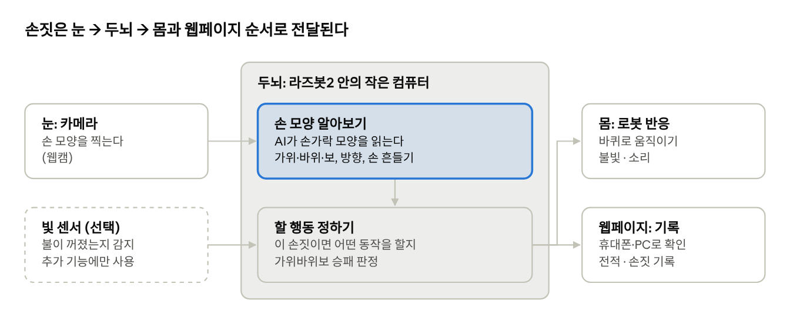
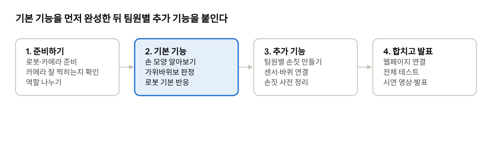

# 일상생활 제스처로 반응하는 로봇 — 라즈봇2 프로젝트 기획서

카메라 앞에서 손을 내밀면 로봇이 그 손동작을 알아보고 움직이는 프로젝트입니다. 리모컨이나 앱 없이, 사람끼리 하듯 손짓으로 로봇과 대화하는 것이 목표입니다.

[PDF로 보기](기획서.pdf) · [착수 개요(A01)](01-brief.md)

## 1. 프로젝트 개요

한 줄로 말하면 **"가위바위보를 할 줄 아는 로봇"**에서 시작해, 팀원마다 새로운 손짓 기능을 하나씩 더해 가는 프로젝트입니다.

| 항목 | 쉽게 말하면 |
| --- | --- |
| 프로젝트명 | 일상생활 제스처(손짓)로 반응하는 로봇 |
| 무엇을 만드나 | 카메라로 손 모양을 보고, 알맞게 움직이는 로봇 |
| 무엇으로 만드나 | 라즈봇2(바퀴 달린 교육용 로봇) + 웹캠(컴퓨터용 카메라) + 웹페이지 |
| 결과는 어디서 보나 | 휴대폰이나 PC 웹페이지에서 게임 전적과 기록 확인 |
| 진행 방식 | 기본 기능은 다 같이 만들고, 팀원마다 원하는 손짓 기능을 하나씩 추가 |

## 2. 왜 이 주제인가요?

팀 회의에서 "손짓에 반응하는 로봇"이 가장 많은 지지를 받았습니다. 손짓은 누구나 배우지 않고도 쓸 수 있는 가장 자연스러운 신호이기 때문입니다.

회의에서 나온 다른 아이디어(불을 끄면 음악 틀기, 세리머니, 골키퍼 등)는 버리지 않고, 각자 맡는 "추가 손짓 기능"으로 살렸습니다.

**우리가 이루려는 것**

1. 카메라 앞에서 가위·바위·보를 내면 로봇이 바로 알아본다.
2. 로봇이 손짓에 맞춰 움직이고, 불빛과 소리로 반응한다.
3. 게임 결과와 기록을 휴대폰·PC 웹페이지에서 볼 수 있다.
4. 팀원 한 명당 새로운 손짓 기능을 최소 1개 더한다.

## 3. 이렇게 사용해요 (기본 기능)

모든 팀원이 함께 만드는 기본 기능은 **가위바위보 로봇**입니다. 사용자 입장에서 한 판을 하면 이렇게 흘러갑니다.

1. **손 내밀기**: 로봇 앞 카메라에 가위, 바위, 보 중 하나를 냅니다.
2. **로봇이 알아보기**: 로봇이 손가락이 몇 개 펴졌는지 보고 "가위구나" 하고 알아차립니다.
3. **로봇도 내기**: 로봇이 무작위로 자기 손을 정하고, 누가 이겼는지 판정합니다.
4. **로봇의 반응**: 이기면 제자리에서 빙글 돌기, 지면 뒤로 주춤, 비기면 좌우로 흔들기 등 불빛·소리와 함께 움직입니다.
5. **웹에서 확인**: 휴대폰이나 PC 웹페이지에 오늘의 전적(몇 승 몇 패)과 기록이 남습니다.

로봇의 반응 동작은 예시이며, 팀에서 재미있게 정하면 됩니다.

## 4. 팀원별 추가 기능 (예시)

기본 기능 위에 팀원마다 "이런 손짓을 하면 이렇게 됐으면 좋겠다"는 기능을 하나씩 더합니다. 아래는 회의 아이디어를 바탕으로 한 예시이며, 담당자가 최종 확정합니다.

| 담당(안) | 기능 이름 | 이런 손짓을 하면 | 로봇은 이렇게 | 더 필요한 것 |
| --- | --- | --- | --- | --- |
| 용석 | 따라하기 + 세리머니 | 팔을 들거나 승리 포즈 | 동작을 따라 하고, 축하 동작 후 웹에 기록 | - |
| 장우진 | 잠들기 도우미 | 손으로 빛 센서를 가리기(불 끄기) | 조금 뒤 수면 음악 틀기 | 빛 센서, 아두이노 |
| 장우진 | 손가락 운전 | 손가락으로 방향 가리키기 | 그 방향으로 이동·회전·멈춤 | - |
| 황인주 | 로봇 골키퍼 | 공을 왼쪽·가운데·오른쪽으로 굴리기 | 공 방향으로 옆으로 미끄러져 막기, 웹 점수판 | 옆으로도 가는 바퀴(필요 시) |
| 오수진 | 무드등 리모컨 | 손 펼치기 / 주먹 쥐기 | 불 켜기 / 끄기, 소리 내기 | LED 조명 |
| 이희용 | 가위바위보 로봇 | 가위·바위·보 | 승부 후 반응, 웹에 전적 기록 | - |

## 5. 로봇은 어떻게 알아보나요?

사람에 비유하면 카메라가 눈, 라즈봇2 안의 작은 컴퓨터가 두뇌, 바퀴와 불빛이 몸입니다. 두뇌가 손 모양을 알아보고 할 행동을 정하면, 로봇이 움직이고 결과가 웹페이지에 남습니다.

| 역할 | 실제로 쓰는 것 | 비고 |
| --- | --- | --- |
| 눈 | 웹캠 | 모두 사용 |
| 두뇌 | 라즈봇2에 들어 있는 라즈베리 파이 + 손 모양을 읽는 AI(MediaPipe) | 모두 사용 |
| 몸 | 라즈봇2의 바퀴, LED, 부저 | 모두 사용 |
| 기록 | 웹페이지(Flask로 제작) | 모두 사용 |
| 추가 부품 | 빛 센서, 아두이노/ESP32-S3, LED 조명, 옆으로 가는 바퀴 | 추가 기능별로 필요할 때만 |

## 6. 손짓 사전 (초안)

로봇이 알아듣는 손짓과, 그때 로봇이 하는 행동을 정리한 표입니다. 새 손짓을 추가할 때는 여기에 먼저 적어 겹치지 않게 합니다.

| 손짓 | 손 모양 | 로봇의 행동 | 웹페이지에 남는 것 |
| --- | --- | --- | --- |
| 가위 | 검지·중지만 펼침 | 가위바위보 승부 | 게임 결과 |
| 바위 | 주먹 | 가위바위보 승부 / 멈춤 | 게임 결과 |
| 보 | 손바닥 펼침 | 가위바위보 승부 / 불 켜기 | 게임 결과 |
| 최고! | 엄지 척 | 제자리에서 빙글 돌기 | 손짓 기록 |
| 저쪽으로 | 검지로 왼쪽·오른쪽 가리키기 | 그 방향으로 돌기·이동 | 손짓 기록 |
| 안녕! | 손 좌우로 흔들기 | 좌우로 흔들며 삐 소리로 인사 | 손짓 기록 |

실수로 반응하지 않도록, 같은 손 모양이 잠깐 유지될 때만 로봇이 움직입니다.

## 7. 진행 순서와 역할

가위바위보 로봇(2단계)이 제대로 작동한 다음에 팀원별 추가 기능(3단계)을 붙입니다. 단계별 기간은 수업 일정에 맞춰 팀이 정합니다.

| 담당(안) | 기본 기능에서 맡을 일 | 내 추가 기능 |
| --- | --- | --- |
| 이희용 | 전체 진행, 가위바위보 규칙 만들기 | 가위바위보 로봇 |
| 용석 | 카메라로 손 모양 알아보기 | 따라하기 + 세리머니 |
| 장우진 | 로봇 움직이기(바퀴) | 잠들기 도우미, 손가락 운전 |
| 황인주 | 기록 웹페이지 만들기 | 로봇 골키퍼 |
| 오수진 | 웹페이지 연결·전체 테스트 | 무드등 리모컨 |

- [ ] 단계별 마감일 정하기
- [ ] 팀원별 확장 제스처 확정하기

## 8. 기대하는 점과 걱정되는 점

**기대하는 점**

- 리모컨이나 앱 없이 손짓만으로 로봇을 다루는 경험을 할 수 있습니다.
- AI(손 모양 읽기), 로봇 움직이기, 웹페이지 만들기를 한 프로젝트에서 모두 배웁니다.
- 기본 기능 위에 각자 기능을 올리는 구조라, 누가 무엇을 맡을지 분명합니다.

**걱정되는 점과 해결 방법**

| 걱정되는 점 | 이렇게 해결해요 |
| --- | --- |
| 어둡거나 배경이 복잡하면 손을 잘 못 알아봄 | 밝은 곳, 단색 배경에서 시연하고, 같은 손 모양이 잠깐 유지될 때만 반응 |
| 로봇 안 컴퓨터가 느려서 반응이 늦음 | 카메라 화질을 낮추거나, 노트북에서 손을 알아본 뒤 로봇에는 명령만 보내기 |
| 팀원들의 손짓이 서로 겹침 | 손짓 사전(6장)에 먼저 등록하고, 모드를 바꾸는 손짓 두기 |
| 추가 부품(센서·바퀴) 연결이 늦어짐 | 기본 기능을 먼저 완성하고, 추가 부품은 선택 기능으로 두기 |

## 용어 풀이

| 용어 | 뜻 |
| --- | --- |
| 제스처 | 손짓·몸짓. 이 프로젝트에서는 주로 손 모양 |
| 라즈봇2 | 바퀴와 LED가 달린 교육용 로봇. 안에 라즈베리 파이가 들어 있음 |
| 라즈베리 파이 | 손바닥만 한 작은 컴퓨터. 로봇의 두뇌 역할 |
| 웹캠 | 컴퓨터에 연결하는 작은 카메라 |
| MediaPipe | 구글이 만든 무료 AI 도구. 영상에서 손가락 위치를 찾아줌 |
| 아두이노 / ESP32-S3 | 센서를 연결할 때 쓰는 작은 제어 보드 |
| Flask | 간단한 웹페이지를 만드는 파이썬 도구 |
